# Government College of Engineering, Kolhapur (GCOEK MIS)
## Comprehensive User Manual & Operations Guide
**Academic Administration, Student Lifecycle, Division Governance & Promotion Workflows**

---

### Document Control

| Property | Details |
| :--- | :--- |
| **System Name** | Government College of Engineering Kolhapur — College Management System (GCOEK MIS) |
| **Document Version** | 2.1 (Updated: Streamlined Operations Edition) |
| **Target Audience** | Students, Faculty / Class Teachers, Heads of Department (HODs), Administrators |
| **Document Purpose** | Comprehensive operational manual covering authentication, student profile lifecycle, admission onboarding, division and batch configuration, class teacher assignment, class promotion, and repeater class management. |
| **Operational Notice** | *Student Examination Results and Result-Based Eligibility Verification workflows are temporarily paused in the current release. Progression is governed via Student Profile Locking and Fee Clearance.* |
| **Publication Date** | Academic Session 2026–2027 |

---

## Table of Contents

1. [Executive Summary & System Overview](#1-executive-summary--system-overview)
2. [User Roles & Permissions Matrix](#2-user-roles--permissions-matrix)
3. [Module 1: Authentication, Login & Account Management](#3-module-1-authentication-login--account-management)
   - 3.1 Portal URL and Access
   - 3.2 Student Login Credentials & First-Time Login Policy
   - 3.3 Faculty and HOD Login
   - 3.4 Password Reset & Account Security
4. [Module 2: Student Portal Guide](#4-module-2-student-portal-guide)
   - 4.1 Student Dashboard Overview
   - 4.2 Profile Management: Registration & Personal Details
   - 4.3 Profile Management: Photograph & Signature Upload
   - 4.4 Profile Management: Aadhaar Details Verification
   - 4.5 Profile Management: Bank Account Information
   - 4.6 One-Time Self-Service Profile Locking
   - 4.7 Student Fees & Payment Ledger
5. [Module 3: Student Onboarding & Admission Administration](#5-module-3-student-onboarding--admission-administration)
   - 5.1 Central Administration Dashboard Overview
   - 5.2 Government DTE Excel Ingestion Pipeline
   - 5.3 First Year (FY) vs. Direct Second Year (DSE Lateral Entry)
   - 5.4 Automatic Account Creation & Initial Enrollment
6. [Module 4: Head of Department (HOD) Operations](#6-module-4-head-of-department-hod-operations)
   - 6.1 Department Dashboard & Academic Statistics
   - 6.2 Managing Classes, Divisions & Lab Batches
   - 6.3 Deciding Divisions & Seat Capacities
   - 6.4 Assigning & Changing Class Teachers
   - 6.5 Seating Students into Divisions and Practical Batches
   - 6.6 Class Promotion & Rollover Workflow
   - 6.7 Creating & Managing Repeater Classes (Division R)
7. [Module 5: Class Teacher (Faculty) Operations](#7-module-5-class-teacher-faculty-operations)
   - 7.1 My Class: Division Roster & Academic Tracking
   - 7.2 Monitoring Student Profile Completion & Lock Status
   - 7.3 Student Oversight & Communication
8. [Module 6: Academic Governance, Promotion Rules & Repeater Transition](#8-module-6-academic-governance-promotion-rules--repeater-transition)
   - 8.1 The Two Active Prerequisites for Class Promotion
   - 8.2 In-Place Semester Flip vs. Partial Class Splitting
   - 8.3 Transition & Re-integration Rules for Repeater Students
9. [Module 7: Troubleshooting, FAQs & Support](#9-module-7-troubleshooting-faqs--support)

---

## 1. Executive Summary & System Overview

The **Government College of Engineering, Kolhapur Management Information System (GCOEK MIS)** is a unified academic ERP platform developed to modernize institutional workflows, digitize student lifecycle management, enforce academic governance, and provide transparency across all tiers of college administration.

The system replaces manual paperwork and outdated legacy portals with a high-performance web architecture designed for:
- **Zero Data Loss**: Authoritative academic histories, student enrollments, and fee transactions are preserved with immutable audit trails.
- **Role-Based Workflow Automation**: Streamlined progression where admitted students complete profiles, HODs structure divisions and assign Class Teachers, and students advance upon fee clearance.
- **Government Compliance**: Fully compliant with Maharashtra DTE centralized admission lists and state scholarship protocols (EBC, Freeship, Caste-based schemes).

---

## 2. User Roles & Permissions Matrix

GCOEK MIS uses strict Role-Based Access Control (RBAC) and scoped data filters to ensure staff access only records within their authorized department or division:

| Role | Operational Scope | Key Capabilities |
| :--- | :--- | :--- |
| **Student** | Own Profile | View personal dashboard, update bio-data/Aadhaar/bank details, upload photo/signature, view fee ledger and payment history, lock profile. |
| **Faculty (Teacher)** | Teaching Load | View departmental subject rosters and academic structure. |
| **Class Teacher** | Assigned Division | View "My Class" roster, monitor student registration and profile lock status, track student contact info, report class progression readiness to HOD. |
| **Head of Department (HOD)** | Entire Department | Department dashboard, create/manage **Divisions** and **Lab Batches**, assign/reassign **Class Teachers**, allocate students, execute **Class Promotion**, create and manage **Repeater Classes (Div R)**. |
| **Administrative Head** | College-wide | Ingest government DTE admission Excel sheets, manage institutional student directory, configure fee heads and fee structures, view executive analytics. |
| **Accountant** | College-wide | Operate Candidate Fee Desk, record online/offline fee collections, view payment ledger, mark fee clearance to unlock student promotion. |
| **System Administrator** | System-wide | Manage global academic calendar years, activate operational terms (Odd/Even/Summer), manage staff user accounts and role permissions. |

---

## 3. Module 1: Authentication, Login & Account Management

### 3.1 Portal URL and Access

Users can access the GCOEK MIS portal from any modern desktop or mobile browser (Google Chrome, Mozilla Firefox, Microsoft Edge, or Safari):

- **Institutional Web Portal**: `http://localhost:5173/login` (or official college domain `https://mis.gceok.ac.in`)
- **Supported Devices**: PC, Laptop, Tablet, Smartphone (Fully Responsive UI).

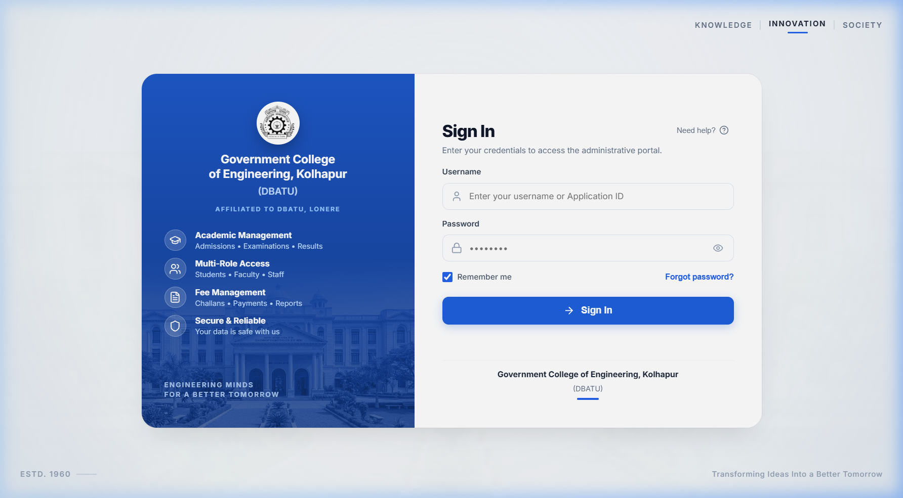
*Figure 3.1: GCOEK MIS Secure Login Interface featuring College Seal, institutional credentials, and responsive branding.*

### 3.2 Student Login Credentials & First-Time Login Policy

Student accounts are provisioned automatically upon admission from the government merit lists.

- **Username**: Your **Roll Number** (e.g., `24060361293504`) or **DTE Application ID** (e.g., `EN26123456`).
- **Initial Password**: Set by the administration during onboarding (default: `Student@123` or your Roll Number as communicated in your admission slip).
- **First-Time Login Mandate**: 
  - Upon your first successful authentication, the system prompts you to change your password via the **Mandatory Password Reset** screen.
  - The new password must be at least 8 characters long and contain a mix of uppercase letters, lowercase letters, numbers, and symbols.
  - You must not share your credentials with anyone.

### 3.3 Faculty and HOD Login

Faculty members and Heads of Department log in using their institutional email or allocated staff username:
- **Username**: Institutional username (e.g., `hod_cse`, `faculty_ee2`, `admin_head`).
- **Password**: Secure staff password assigned by the System Administrator.
- **Departmental Scoping**: Upon login, the system automatically loads the department and assigned divisions corresponding to the staff member's active appointments.

### 3.4 Password Reset & Account Security

1. If you forget your password, contact your **Department Class Teacher** or the **MIS Helpdesk** for a verified password reset.
2. Always click the **Sign Out** button in the sidebar or top user menu before leaving a public terminal or shared computer.

---

## 4. Module 2: Student Portal Guide

The Student Portal is the self-service hub for enrolled students to manage their official bio-data, complete required verifications, monitor fees, and track their academic progression.

### 4.1 Student Dashboard Overview

After signing in, students are greeted by the modern, card-based **Student Dashboard**:

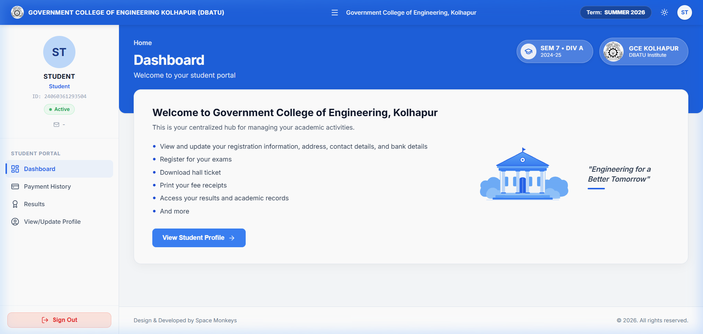
*Figure 4.1: Student Dashboard showing current semester enrollment, quick actions, fees status, and announcements.*

**Key Dashboard Components**:
1. **Academic Status Card**: Displays current Semester, Academic Year, Department (e.g., Electrical Engineering), Division, and Roll Number.
2. **Fee Summary Banner**: Shows Total Assessed Fee, Amount Paid, and Outstanding Balance Due.
3. **Quick Navigation Tiles**: Direct shortcuts to *My Profile*, *Fees Desk*, and *Documents*.
4. **Institutional Notifications**: Real-time alerts regarding academic calendar dates, profile locking windows, and fee payment deadlines.

---

### 4.2 Profile Management: Registration & Personal Details

Access via **My Profile &rarr; Registration / Basic Details Tab**:

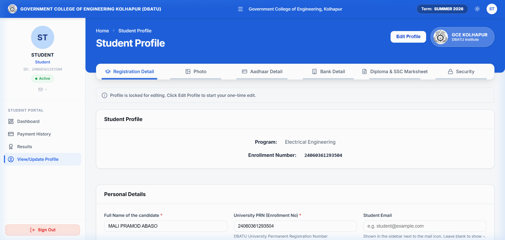
*Figure 4.2: Student Profile — Personal details, Admission Category, and Contact information.*

**Step-by-step instructions**:
1. Verify that your **Full Name**, **Gender**, **Date of Birth**, **Blood Group**, and **Mother Tongue** match your official Higher Secondary / DTE certificates.
2. Confirm your **Admission Category** (OPEN, OBC, SC, ST, EWS, TFWS) and **Admission Quota**.
3. Enter your **Permanent Address** and **Correspondence Address**, including City, District, State, and PIN Code.
4. Keep your **Mobile Number** and **Personal Email Address** current, as all official college announcements and verification notices will be sent to these contacts.
5. Click **Save Changes** at the bottom of the section.

---

### 4.3 Profile Management: Photograph & Signature Upload

Access via **My Profile &rarr; Photo & Signature Tab**:

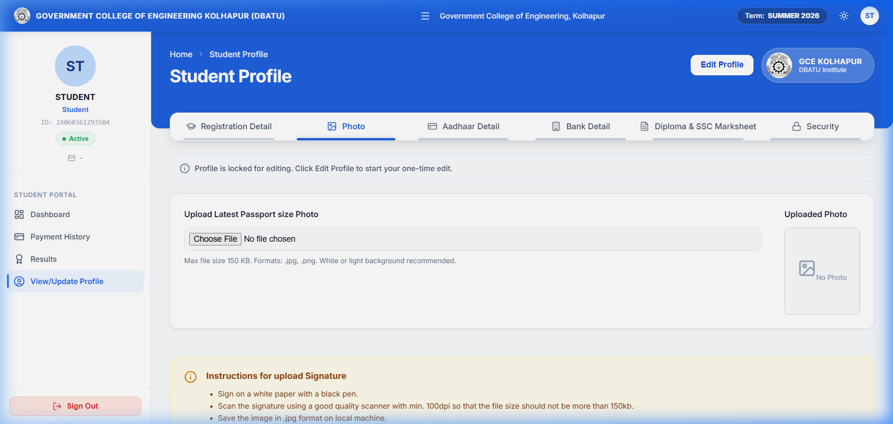
*Figure 4.3: Secure Photo and Signature Upload interface with live preview.*

**Guidelines for Uploads**:
- **Passport Photograph**:
  - Format: JPG, JPEG, or PNG.
  - Dimensions: 3.5 cm x 4.5 cm (recommended file size: between 20 KB and 100 KB).
  - Background: Plain white or off-white background with both ears clearly visible.
- **Specimen Signature**:
  - Sign in black or dark blue ink on clear white paper.
  - Crop tightly around the signature (recommended file size: between 10 KB and 50 KB).
- Click **Upload** to update the server. The live thumbnail confirms successful processing.

---

### 4.4 Profile Management: Aadhaar Details Verification

Access via **My Profile &rarr; Aadhaar Details Tab**:

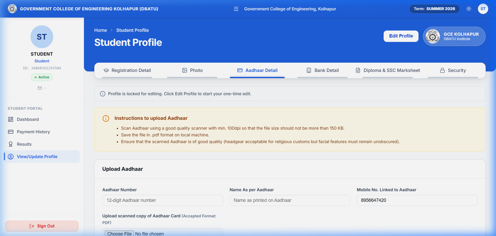
*Figure 4.4: Aadhaar Verification & Masked Storage screen.*

> [!NOTE]
> Under government data protection protocols, GCOEK MIS securely encrypts your 12-digit Aadhaar number and displays only the masked format (e.g., `XXXX-XXXX-1234`) on public screens.

**Steps to Complete**:
1. Enter your **12-digit Aadhaar Number** carefully.
2. Enter your **Name as printed on your Aadhaar Card**.
3. Upload a clear scanned copy of your Aadhaar Card (PDF or JPG format).
4. Click **Verify & Save**. Your Class Teacher will verify this during admission document clearance.

---

### 4.5 Profile Management: Bank Account Information

Access via **My Profile &rarr; Bank Details Tab**:

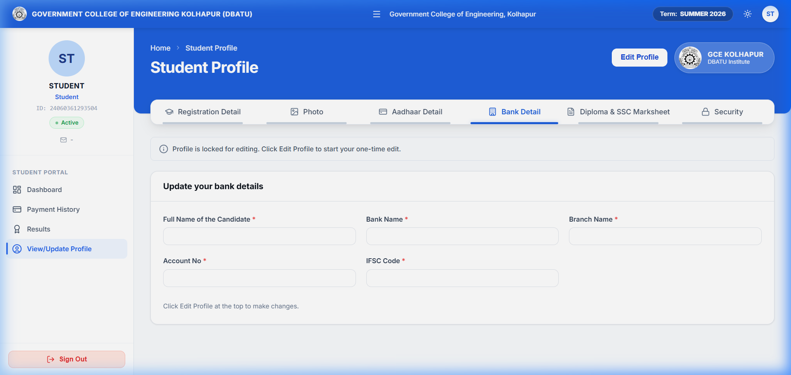
*Figure 4.5: Student Bank Account details screen for DBT scholarships and fee refunds.*

**Required for DBT Scholarships (EBC, Freeship, Swadhar, Caste Scholarships)**:
1. Enter your **Bank Name** (e.g., State Bank of India, Bank of Maharashtra).
2. Enter the **Branch Name** and **IFSC Code** (11 characters). The system auto-validates the branch.
3. Enter your **Savings Account Number** and confirm it in the confirmation box.
4. Upload a scanned copy of your **Cancelled Cheque** or **Bank Passbook front page**.
5. Save the record.

---

### 4.6 One-Time Self-Service Profile Locking

> [!IMPORTANT]
> **One-Time Self-Service Profile Lock**:
> Once you have completed all sections of your profile and uploaded your required documents, you must click **Lock Profile**.
> - Locking your profile finalizes your bio-data for the academic year and signals to your Class Teacher and HOD that your registration is complete.
> - **Class promotion and division placements are unlocked once your profile is verified and locked.**
> - After locking, editing is disabled to ensure data integrity across college registers.

---

### 4.7 Student Fees & Payment Ledger

Access via **Payment History** in the sidebar navigation:

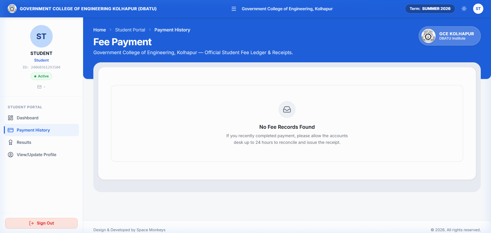
*Figure 4.6: Student Fee Ledger showing fee breakdown, scholarship adjustments, and payment history.*

**Fee Desk Features**:
- **Fee Structure Breakdown**: Itemized view of Tuition Fee, Development Fee, Gymkhana Fee, Library Fee, Examination Fee, and Other Institutional Charges.
- **Scholarship / Concession Deduction**: Displays category concessions (e.g., 50% tuition waiver for EBC, 100% tuition waiver for TFWS/SC/ST).
- **Payment Methods**:
  - **Online Payment**: Integrated UPI, Net Banking, Debit/Credit Card gateway with instant transaction confirmation.
  - **Counter Payment**: If paid at the college accounts counter (cash/challan/DD), the Accountant enters the receipt number, and the balance automatically updates to ₹0.
- **Payment Receipt**: Click **Download Receipt** for any completed payment to generate an official PDF receipt with digital college stamp.

---

## 5. Module 3: Student Onboarding & Admission Administration

The admission process is centrally managed by the **Administrative Head** and **Academic Registrar**.

### 5.1 Central Administration Dashboard Overview

Upon logging in, the Administrative Head accesses the **Central Administration Dashboard**:

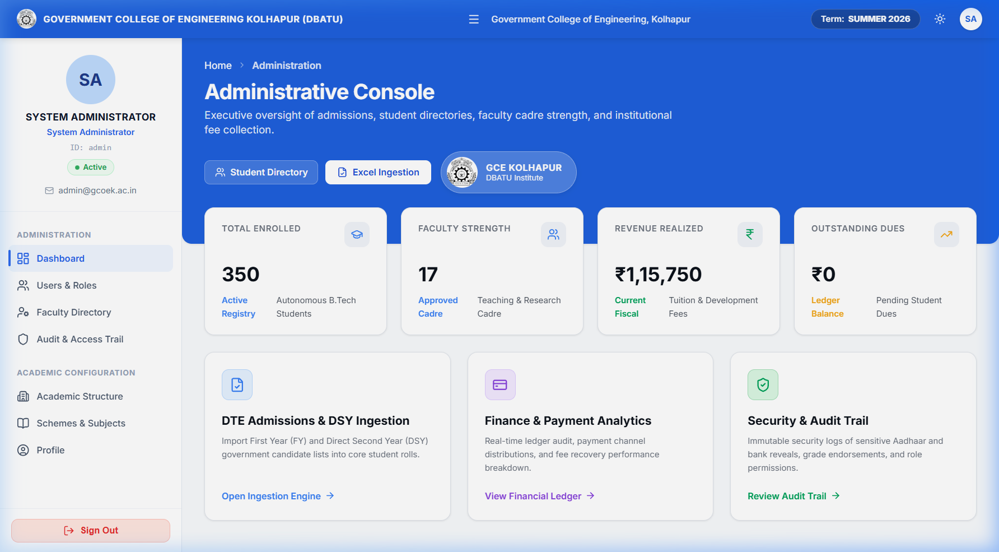
*Figure 5.1: Central Administration Dashboard showing admission intake statistics and system health.*

**Administrative Capabilities**:
- Live monitoring of student onboarding numbers across all engineering departments.
- Status of government allotment batches and seat filling ratios.
- Direct access to student directory filters, fee head setup, and institutional audit trails.

### 5.2 Government DTE Excel Ingestion Pipeline

At the beginning of each academic session, the college receives the official Maharashtra State Common Entrance Test (CET) Cell / Directorate of Technical Education (DTE) centralized admission allotment Excel spreadsheets.

GCOEK MIS incorporates a resilient 5-stage ingestion engine to eliminate manual data entry errors:

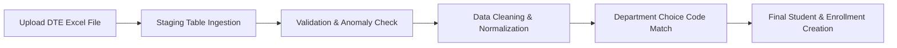

1. **Step 1: Upload**: The Admin Head navigates to **Admissions &rarr; Government Ingestion** and uploads the raw `.xlsx` allotment list. The original file is stored immutably in secure storage.
2. **Step 2: Staging**: Every row is read into an isolated staging buffer without affecting live student tables.
3. **Step 3: Validation**: The engine validates:
   - Unique Application IDs (e.g., `EN26...`).
   - Valid Maharashtra CET percentile scores and HSC aggregate marks.
   - Category codes (OPEN, OBC, SC, ST, SEBC, EWS, TFWS).
4. **Step 4: Department Matching**: The engine matches the DTE choice codes (e.g., `603624210` for CSE, `603629310` for Electrical) directly to the corresponding academic department in the database.
5. **Step 5: Final Import**: Upon approval, the system:
   - Creates the core `Student` record.
   - Generates the student's initial active `StudentEnrollment` record.
   - Sets up the `PaymentLedger` row based on the student's admission quota and fee category.
   - Provisions the student login user account with auto-generated credentials.

### 5.3 First Year (FY) vs. Direct Second Year (DSE Lateral Entry)

- **First Year (FY)**: Students are enrolled in **Semester 1**.
- **Direct Second Year (DSE)**: Diploma-holding lateral entry students are enrolled directly into **Semester 3** with `is_direct_second_year = True`. Their previous academic records are tagged with equivalence credits.

---

## 6. Module 4: Head of Department (HOD) Operations

The Head of Department is responsible for academic structure, division sizing, class teacher assignments, student cohort seating, class promotion, and repeater cohorts.

### 6.1 Department Dashboard & Academic Statistics

Upon logging in, the HOD views the **Department Dashboard**:

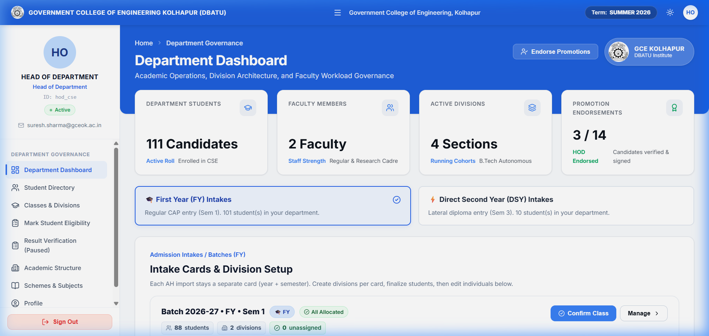
*Figure 6.1: HOD Dashboard displaying departmental enrollment counts, division metrics, and academic statistics.*

**Dashboard Insights**:
- **Total Department Strength**: Breakdown of students across First Year, Second Year, Third Year, and Final Year.
- **Active Divisions & Sections**: Summary of all configured divisions and their assigned Class Teachers.
- **Intake & Capacity Monitoring**: Live overview of approved intake vs. active enrolled students.
- **Progression Readiness**: Students who have completed profile locks and fee clearances.

---

### 6.2 Managing Classes, Divisions & Lab Batches

Navigate to **Department &rarr; Classes & Divisions**:

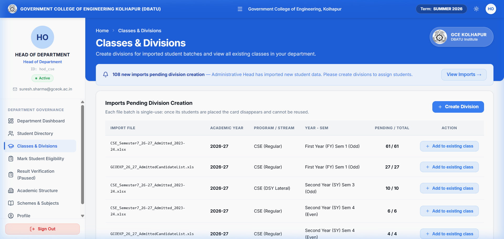
*Figure 6.2: HOD Class Division and Lab Batch Management Console.*

### 6.3 Deciding Divisions & Seat Capacities

HODs decide how many divisions to run per semester based on approved AICTE intake:
1. Click **Create Division** in the top-right corner.
2. Select the **Semester** (e.g., Semester 3, Semester 5).
3. Enter the **Division Name** (e.g., `A`, `B`).
4. Set the **Seat Capacity** (default: `60` students per division).
5. Add **Lab Batches** under the division (e.g., `A1`, `A2`, `A3` with capacity `20` each) for laboratory and practical sessions.

### 6.4 Assigning & Changing Class Teachers

Every division must have exactly one appointed Class Teacher who holds operational authority over that cohort:
1. In the Divisions list, find the target division and click **Assign / Edit Class Teacher**.
2. Select the faculty member from the dropdown roster of active departmental teachers.
3. Enter the appointment reason (e.g., *"Academic Year 2026-27 Appointment"*).
4. Click **Confirm Assignment**.
5. The system immediately transfers division access permissions to the newly assigned teacher and records the change in the immutable audit log.

### 6.5 Seating Students into Divisions and Practical Batches

- When new students are admitted or promoted, they appear in the departmental unassigned pool.
- HODs can allocate students to Division A or B individually or in bulk based on roll numbers or merit rank.
- Assign students to practical lab batches (A1, A2, A3) to balance laboratory equipment utilization.

---

### 6.6 Class Promotion & Rollover Workflow

At the end of an academic term, the HOD initiates the **Class Promotion** workflow from the Classes console:

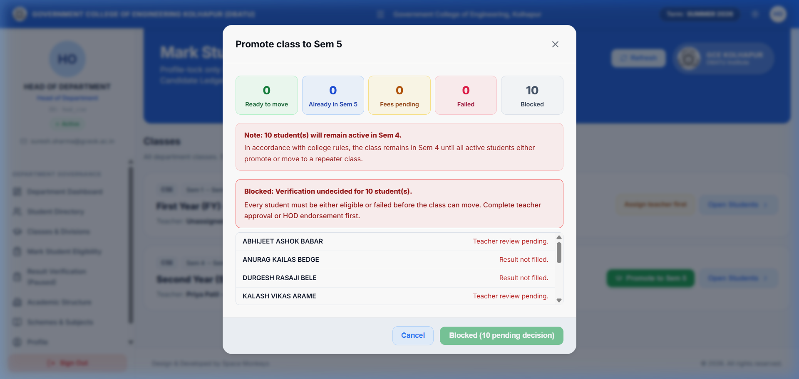
*Figure 6.3: HOD Class Promotion & Repeater Class Management Dialog.*

**Prerequisites for Promotion**:
In the current operational cycle, a student advances to the next semester when they satisfy the **Two Active Prerequisites**:
1. **Profile Completed & Locked**: Bio-data, Aadhaar, and photo/signature finalized.
2. **Fees Fully Paid**: Fee balance is ₹0 (`PaymentLedger.status == PAID` or `balance_due <= 0`).

**Promotion Scenarios Handled Automatically by GCOEK MIS**:
1. **Full Class Flip (100% Cleared)**:
   - When all students in Sem 4 Div A meet the promotion criteria, the division flips in-place to Sem 5 Div A without creating duplicate entities.
2. **Partial Class Split (Mixed Status)**:
   - **Eligible + Paid Students**: Moved forward to the successor class (e.g., Sem 5 Div A). Their previous enrollment is archived as `PROMOTED` and a new active enrollment is generated.
   - **Fees Pending Students**: Remain temporarily in their current semester under a hold status until fees are cleared by Accounts.
   - **Detained / Stay-back Students**: Retained in the current semester level or transferred to a Repeater Class.

---

### 6.7 Creating & Managing Repeater Classes (Division R)

When students are detained due to severe attendance shortages, term work deficiencies, or academic year-down conditions:

1. In the **Promote Class Dialog** (Figure 6.3), select the detained students.
2. Tick the box: **Create Repeater Class**.
3. Specify the **Repeater Division Name** (standard convention: `Div R` or `R`).
4. Select the **Repeater Class Teacher** who will supervise the backlog cohort.
5. Click **Promote & Move Repeaters**:
   - Cleared students advance to the higher semester.
   - Detained students are transferred into **Division R** of their repeating semester.
   - Their `repeat_count` counter increments by 1.
6. **Re-integration**: Once repeater students satisfy term requirements and settle fees, the HOD promotes them back into the standard divisions (`A` or `B`) in the next academic cycle.

---

## 7. Module 5: Class Teacher (Faculty) Operations

Class Teachers provide direct academic mentorship, track student registration, and oversee class cohort progression.

### 7.1 My Class: Division Roster & Academic Tracking

When a faculty member assigned as a Class Teacher navigates to **My Class**, they see their assigned cohort:

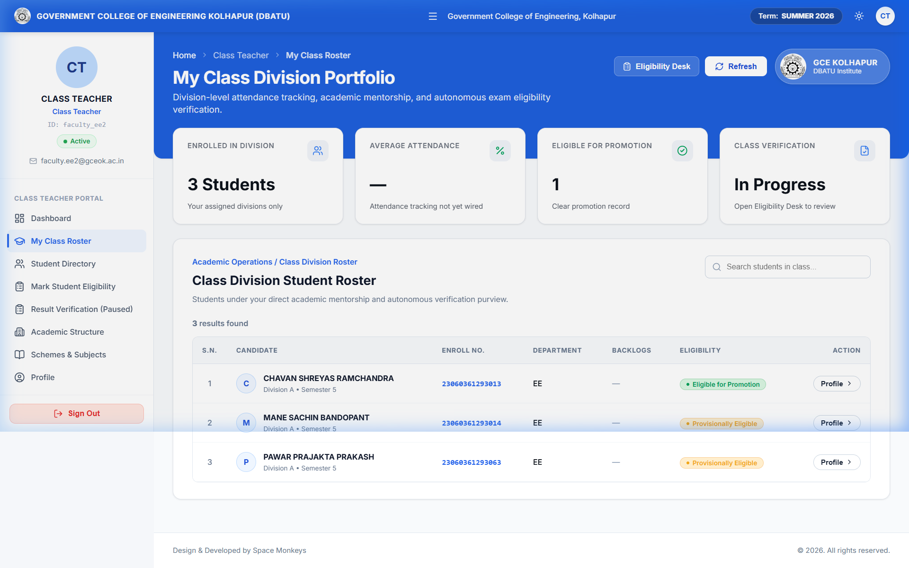
*Figure 7.1: Class Teacher "My Class" console showing student roster, academic status, and contact details.*

**Features & Tools Available to the Class Teacher**:
- **Complete Cohort Roster**: Instant visibility of all students enrolled in the teacher's division.
- **Registration Tracking**: Identifies which students have completed and locked their profiles versus those with pending forms.
- **Contact & Profile Access**: Quick access to student contact details, permanent addresses, and uploaded certificates for verification.
- **Progression Readiness**: Class Teachers monitor which students have settled fees and completed requirements, keeping the HOD updated for promotion planning.

---

## 8. Module 6: Academic Governance, Promotion Rules & Repeater Transition

### 8.1 The Two Active Prerequisites for Class Promotion

The promotion engine advances a student when both conditions are satisfied:

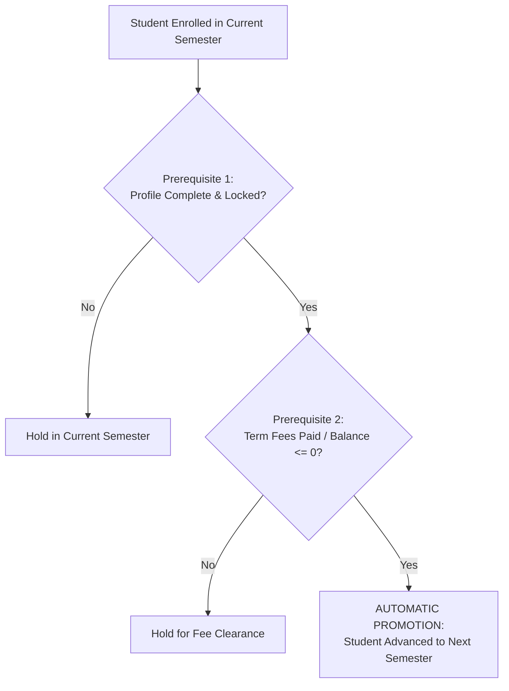

1. **Profile Lock**: `Student.profile_locked == True`.
2. **Fee Clearance**: `PaymentLedger.status == PAID` or `balance_due <= 0`.

> [!WARNING]
> If a student has an outstanding fee balance, the system will hold their promotion until Accounts records payment clearance, ensuring institutional financial compliance.

---

### 8.2 In-Place Semester Flip vs. Partial Class Splitting

- **In-Place Flip**: Occurs when all enrolled students in Division A satisfy all conditions. Division A advances directly from Semester $N$ to Semester $N+1$ without creating duplicate division entities.
- **Partial Split**: If 50 students are ready to advance while 10 have fee holds:
  - The system creates or joins the successor division for Semester $N+1$ and seats the 50 ready students there.
  - The 10 remaining students remain seated in Semester $N$ Div A (or Div R) under teacher oversight until payments are reconciled.

---

### 8.3 Transition & Re-integration Rules for Repeater Students

1. When a student in **Division R** completes their repeat term and clears pending requirements:
2. Upon payment of the promotion term fees, the HOD moves the student from **Division R** back into **Division A** (or Division B) of the higher semester.
3. The historical attendance and repeating tenure are permanently preserved in the student's audit trail.

---

## 9. Module 7: Troubleshooting, FAQs & Support

### Frequently Asked Questions (FAQs)

#### Q1: A student cannot log in and gets an "Invalid Credentials" error.
- **Solution**: Check whether the student is typing their Roll Number or DTE Application ID. For new admissions, ensure the default password is used. If the student has forgotten their password, the Class Teacher or MIS Administrator can trigger a password reset via the staff console.

#### Q2: The student paid fees online, but the status still shows "Fees Pending".
- **Solution**: Online payment gateways usually settle within seconds. If the transaction was interrupted, the student should go to **Payment History** and click **Verify Transaction Status**. Alternatively, provide the bank transaction UTR reference to the College Accounts counter to manually verify the ledger entry.

#### Q3: How does an HOD reassign a Class Teacher mid-term?
- **Solution**: Navigate to **Classes & Divisions &rarr; Select Division &rarr; Assign / Edit Class Teacher**. Choose the new faculty member and click Confirm. Roster views and management permissions transfer immediately with full audit logging.

#### Q4: Why can't a student edit their profile details?
- **Solution**: If the student has already clicked **Lock Profile**, self-service editing is locked to preserve institutional records. If a genuine correction is needed, the student must contact their Class Teacher or HOD to unlock the specific section.

---

### Technical Support & Institutional Helpdesk

For further technical assistance, bug reports, or feature queries:

- **MIS Cell**: Computer Center, 2nd Floor, Main Administrative Building
- **Email Support**: `mis-support@gceok.ac.in`
- **Internal Extension**: 2145 / 2146
- **Working Hours**: Monday to Saturday, 10:00 AM – 5:30 PM
